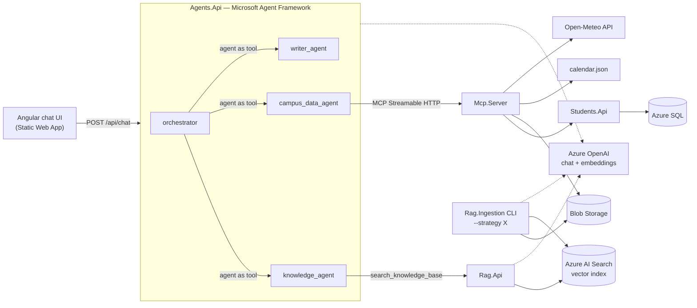

# RAG + MCP + multi-agent platform on Azure (.NET 10, Angular 22)

An end-to-end reference solution with four parts:

| # | Part | What it does | Code |
|---|------|--------------|------|
| 1 | **RAG ingestion + API** | Pulls documents from **Azure Blob Storage**, chunks them with a **strategy you pick at run time** (7 options), embeds them with Azure OpenAI and stores the vectors in **Azure AI Search**. Exposes hybrid vector search and a RAG "ask" endpoint. | `src/Rag` |
| 2 | **Students Web API + MCP server** | ASP.NET Core Web API over **SQL Server / Azure SQL** (students, courses, enrollments, grades). A **Model Context Protocol server** exposes tools that pull from several sources: the Students API, Blob Storage, an academic-calendar data file and a live weather API. | `src/Students`, `src/Mcp` |
| 3 | **Multi-agent API** | Built with **Microsoft Agent Framework**. An orchestrator agent decides per request whether to call the **vector database** (knowledge agent), the **MCP server** (campus data agent) or **another agent** (writer agent), or several of them in sequence, then returns the answer and a trace of every step. | `src/Agents` |
| 4 | **Angular chat front end** | Chat UI that calls the multi-agent API, renders Markdown answers and shows how each answer was produced. | `src/Frontend/chat-ui` |

Plus **Bicep infrastructure** (`infra/`), **GitHub Actions CI/CD** for every project (`.github/workflows/`) and a **.NET Aspire AppHost** that runs and debugs everything locally with one F5.



## Repository layout

```
RagPlatform.slnx                  solution (all .NET projects)
src/
  Aspire/RagPlatform.AppHost      local orchestration + dashboard (F5 here)
  Aspire/RagPlatform.ServiceDefaults  OpenTelemetry, health checks, resilience
  Rag/Rag.Core                    chunkers, Blob loader, embeddings, AI Search index, ingestion pipeline
  Rag/Rag.Ingestion               console app: choose the chunking strategy when you run it
  Rag/Rag.Api                     /api/ingest, /api/search, /api/ask, /api/stats
  Students/Students.Api           EF Core + SQL Server student information API
  Mcp/Mcp.Server                  MCP server (tools over 4 data sources)
  Agents/Agents.Api               multi-agent orchestration (Microsoft Agent Framework)
  Frontend/chat-ui                Angular chat app
tests/Rag.Core.Tests              unit tests for every chunking strategy
samples/documents                 sample policy/guide documents to ingest
infra/main.bicep                  all Azure resources (managed identity, no keys)
.github/workflows                 CI + one deployment pipeline per project
docs/                             local development and Azure setup guides
```

## Project 1 — RAG with selectable chunking strategies

| Strategy | How it splits | Good for |
|----------|---------------|----------|
| `FixedSize` | Fixed character windows, no overlap | Baseline, very fast |
| `SlidingWindow` | Fixed windows with overlap | Dense text where context crosses boundaries |
| `Sentence` | Whole sentences packed up to the size limit | Prose, FAQs |
| `Paragraph` | Whole paragraphs packed up to the size limit | Well-structured documents |
| `Recursive` | Paragraph → line → sentence → word (LangChain style) | Good general default |
| `Markdown` | Splits on headings, keeps the heading path (`Handbook > Leave > Sick leave`) | Markdown docs, handbooks |
| `Semantic` | Embeds sentences and cuts where the meaning shifts | Mixed-topic documents |

All strategies write to **one index** with a filterable `strategy` field. You can ingest the same documents with several strategies and compare retrieval quality (`/api/search` with `"strategy": "Markdown"` versus `"Recursive"`). Supported files: PDF, DOCX, MD, TXT, HTML, CSV, JSON.

**Choose the strategy when you run it:**

```bash
# interactive menu
dotnet run --project src/Rag/Rag.Ingestion

# explicit
dotnet run --project src/Rag/Rag.Ingestion -- --strategy Semantic --chunk-size 1000 --overlap 150
dotnet run --project src/Rag/Rag.Ingestion -- --upload samples/documents --strategy Markdown --recreate-index
dotnet run --project src/Rag/Rag.Ingestion -- --list-strategies

# over HTTP
curl -X POST localhost:5101/api/ingest -H "content-type: application/json" -d '{"strategy":"Recursive"}'

# in Azure: Actions → "RAG (ingestion + API)" → Run workflow → pick the strategy from the dropdown
```

## Project 2 — Students API + MCP server

* `Students.Api`: `/api/students` (search, filter, paging, CRUD), `/api/students/{id}/enrollments`, `/api/courses`, `/api/courses/{code}/students`, `/api/stats/majors`. On first run it creates the schema and seeds 60 students, 10 courses and their enrollments.
* `Mcp.Server`: MCP over Streamable HTTP at `/mcp`. It has 11 tools: `search_students`, `get_student`, `get_student_enrollments`, `list_courses`, `get_course_roster`, `get_major_statistics` (Students API → SQL), `list_documents`, `read_text_document` (Blob Storage), `get_academic_calendar`, `get_upcoming_events` (JSON data file), `get_weather` (Open-Meteo). You can also use it from VS Code / Claude / any MCP client. In Azure it is protected by an `X-Api-Key` header.

## Project 3 — Multi-agent API (Microsoft Agent Framework)

`POST /api/chat` `{ "message": "...", "conversationId": "optional", "agent": "auto|knowledge|campus|writer" }`

* **orchestrator** receives every message and calls specialists through the *agent-as-tool* pattern (`AIAgent.AsAIFunction()`). It can call one specialist, call several, or chain them. For example, *"email student S2026005 their grades"* runs `campus_data_agent` and then `writer_agent`.
* **knowledge_agent** calls `search_knowledge_base` → `Rag.Api` → Azure AI Search.
* **campus_data_agent** gets its tools dynamically from the MCP server (`McpClient.ListToolsAsync()`).
* **writer_agent** is a tool-less agent for drafting and rewriting text.
* Conversation history is kept per `conversationId` (`AgentSession`, 30-minute sliding expiry).
* The response includes `steps[]`, which shows each agent hand-off and each tool call with its inputs and timings. The UI displays these steps under "How this was answered".

## Run and debug everything locally — yes, you can

**Short answer: yes.** Press F5 on `RagPlatform.AppHost` in Visual Studio 2026, VS Code (C# Dev Kit) or Rider. This starts:

* the Blob Storage emulator (Azurite, run with npm by default, so no Docker is needed) and SQL Server (your own server, or a Docker container), with sample data seeded automatically
* `Rag.Api`, `Students.Api`, `Mcp.Server` and `Agents.Api` as normal .NET processes, so breakpoints work in all of them at once
* the Angular dev server on http://localhost:4200 (`/api` is proxied to `Agents.Api`)
* the **Aspire dashboard**, with logs, distributed traces (you can follow a chat request through orchestrator → agent → MCP → SQL) and metrics

Azure OpenAI and Azure AI Search have **no local emulators**, so locally you point at real (dev) instances. Set them once:

```bash
cd src/Aspire/RagPlatform.AppHost
dotnet user-secrets set "Azure:OpenAI:Endpoint" "https://<your-aoai>.openai.azure.com/"
dotnet user-secrets set "Azure:Search:Endpoint" "https://<your-search>.search.windows.net"
az login   # or add Azure:OpenAI:ApiKey / Azure:Search:ApiKey secrets instead
```

Everything else (SQL, Storage, MCP, all APIs, UI) runs on your machine. [docs/local-development.md](docs/local-development.md) covers prerequisites, debugging tips, running without Aspire, testing the MCP server with MCP Inspector, and troubleshooting.

## Deploy to Azure with GitHub Actions

| Workflow | Trigger | Deploys |
|----------|---------|---------|
| `ci.yml` | every PR / push | build + tests (.NET, Angular, Bicep) |
| `infra.yml` | `infra/**` or manual | all Azure resources from `infra/main.bicep` |
| `rag.yml` | `src/Rag/**` or manual | `Rag.Api` to App Service; manual run can also **run ingestion with a chosen strategy** |
| `students-mcp.yml` | `src/Students/**`, `src/Mcp/**` | `Students.Api` then `Mcp.Server` |
| `agents.yml` | `src/Agents/**` | `Agents.Api` |
| `frontend.yml` | `src/Frontend/**` | Angular app to Static Web Apps |

Authentication uses **OpenID Connect** (no stored Azure secrets). The apps use one **user-assigned managed identity** with RBAC to Storage, AI Search, Azure OpenAI and Azure SQL, so no keys or passwords are kept in configuration. [docs/azure-deployment.md](docs/azure-deployment.md) has the one-time setup: service principal, federated credentials, GitHub variables, and the first deployment.

## Tech stack

.NET 10 · ASP.NET Core minimal APIs · Microsoft Agent Framework 1.25 · Microsoft.Extensions.AI · Model Context Protocol C# SDK 2.2 · Azure AI Search SDK 12 · OpenAI .NET SDK 2.14 (Azure OpenAI v1 endpoint) · EF Core 10 · .NET Aspire 13 · Angular 22 (standalone, signals, zoneless) · Bicep · GitHub Actions
